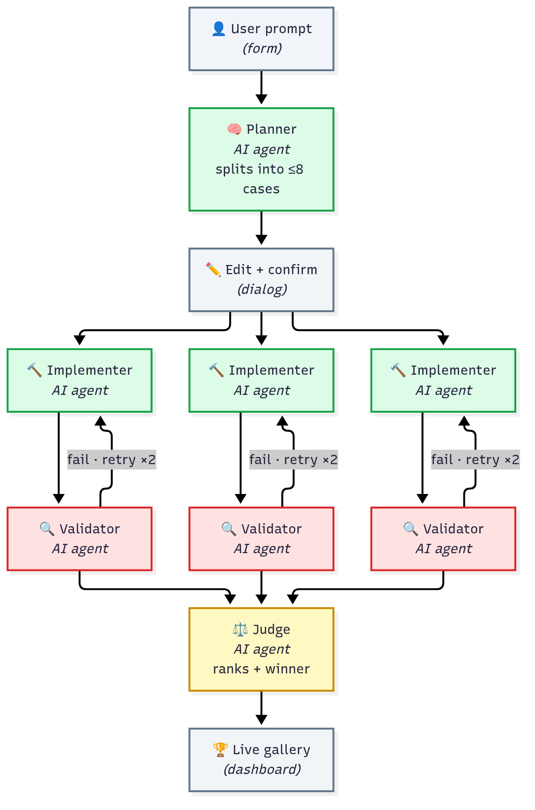

# Squadron

Squadron is a multi-agent web-builder arena: submit **one** brief for a web
project, and N AI agents each build a complete site in parallel, each in its
own [Fly.io Sprite](https://sprites.dev). Paired validators review every lane,
a judge agent compares the surviving candidates (screenshots included) and
crowns a winner, and a live gallery dashboard — server-rendered Askama +
htmx with a Svelte island, streaming over SSE — tracks the whole run from
brief to verdict. The control plane is Rust: axum HTTP server, SQLx/SQLite
persistence, a lane state machine and slot-limited pipeline, and a prompt
schema gate.

The full agent workflow:



## Architecture

Six-crate Cargo workspace plus the binary crate that ties it together:

| Crate | Role |
| --- | --- |
| `squadron` | axum app: gallery dashboard (Askama templates, htmx, Svelte island), REST/SSE API, fixtures, wiring, entrypoint |
| `orchestrator` | lane state machine, slot semaphore (max running lanes), pipeline (impl → validate → judge), screenshots, artifacts, harness, judge, SSE snapshots |
| `prompts` | role prompts (implementer/validator/judge/variants), serde output types, JSON Schema documents, schema gate + injection scan |
| `sprites-client` | typed wrapper over the `sprite` CLI (create/exec/info/config), mock CLI + fixtures for tests |
| `llm-gateway` | machine LLM client (judge/variants) via `OPENCODE_KEY`, and the no-auth opencode gateway recipe builder |
| `store` | SQLx/SQLite store: runs, lanes, lane events, costs, validator reports; offline prepared-query cache |

Data flow per run: `POST /runs` (brief + N) → each lane gets a fresh Sprite
(`squadron-<run>-impl-<i>`), the implementer agent builds and serves the site on
its public `*.sprites.app` URL, a 200-check verifies it, two validators
review and report, then the judge (real LLM with `OPENCODE_KEY`, or the
deterministic fallback) renders the lanes and picks a winner. Every state
change is persisted and pushed to the dashboard via SSE.

## Quickstart

Requirements: Rust 1.75+ (edition 2021), `sqlite3` available via sqlx (bundled),
and the `sprite` CLI on `PATH` for real runs.

Environment variables:

| Variable | Meaning | Default |
| --- | --- | --- |
| `OPENCODE_KEY` | API key for the machine judge/variants client. Without it the judge falls back to a deterministic stub (dev/test only). | unset |
| `DATABASE_URL` | SQLite URL (also accepts `SQUADRON_DB_URL`). | `sqlite:/data/squadron.db?mode=rwc` |
| `DATA_DIR` | Work dir for per-lane artifacts, screenshots, tarballs. | `/data` |
| `BIND` | Listen address (`host:port`). `PORT` is used instead when `BIND` is unset. | `0.0.0.0:3000` |
| `SQUADRON_STATIC_DIR` | Directory with compiled static assets (JS/CSS). | embedded `static/` |
| `SPRITE_CLI` | Path to the `sprite` CLI binary. | `sprite` on `PATH` |
| `SPRITE_TOKEN` | Sprite org token (secret — set via `fly secrets`, never in files). | unset |
| `SQUADRON_TEST_MODE` | `1` = skip real network checks/probes (offline smoke mode). | unset |
| `SQUADRON_FIXTURES` | `1` = serve canned fixture runs under `/__fixtures/*` for UI dev. | unset |

Build and run:

```sh
SQLX_OFFLINE=true cargo build --release -p squadron
DATABASE_URL=sqlite:$PWD/dev.db?mode=rwc DATA_DIR=$PWD/work OPENCODE_KEY=sk-... \
  ./target/release/squadron
```

Then open `http://localhost:3000` and submit a brief. Run status, lanes,
validator reports, screenshots, and the verdict all stream in on the run page.

### Local dev without real sprites

The `sprites-client` crate ships a mock `sprite` CLI (`mock-sprite-cli`) and a
compiled fixture binary, so a full pipeline runs on your laptop with no
network, no Fly account, and no Chromium:

```sh
cargo build -p sprites-client --bins
SPRITE_CLI=$PWD/target/debug/mock-sprite-cli \
SQUADRON_TEST_MODE=1 SQUADRON_FIXTURES=1 \
DATABASE_URL=sqlite:$PWD/dev.db?mode=rwc DATA_DIR=$PWD/work \
  cargo run -p squadron
```

`SQUADRON_TEST_MODE=1` short-circuits the HTTP 200-checks and judge screenshot
extraction; canned implementer/validator JSON passes the schema gate, and the
judge uses its schema-valid fallback verdict. `SQUADRON_FIXTURES=1` additionally
exposes pre-rendered example runs for dashboard styling.

## Deploy

Deploy targets Fly.io: the Dockerfile builds the release binary multi-stage,
then ships a Debian runtime with Chromium + fonts (for lane screenshots), the
`sprite` CLI (official installer), and `tokei` prebuilt. The Fly app mounts a
persistent volume at `/data` for SQLite and artifacts (see `fly.toml`).

```sh
fly launch        # or: fly apps create squadron
fly volumes create squadron_data --size 10
fly secrets set OPENCODE_KEY=... SPRITE_TOKEN=...
fly deploy
```

Lane sprites are provisioned at runtime through the `sprite` CLI (the
`SPRITE_TOKEN` secret authenticates the boot step); nothing else needs to be
manually created.

